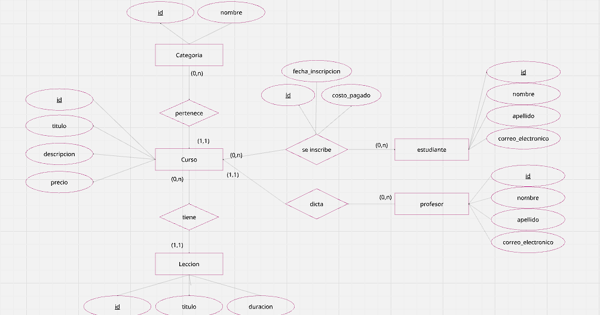

# EduTech: modelado, consultas y testing de una base de datos relacional

Proyecto de práctica de bases de datos relacionales. Recorre tres etapas, en este orden:

1. **Modelar** una base de datos a partir de un documento de requerimientos.
2. **Consultar** la base con SQL, de lo básico a lo avanzado.
3. **Testear** la base con casos de prueba, con evidencia de cada paso.

**Autora:** Larisa Warenycia

## Tecnologías

- **MySQL / MariaDB**, instalado con XAMPP.
- **phpMyAdmin**, para gestionar la base, ejecutar las sentencias y tomar las capturas.

## El problema

EduTech es una plataforma de cursos en línea. La base de datos gestiona las **categorías** en las que se clasifican los cursos, los **profesores** que los dictan, los **estudiantes** registrados, los **cursos** con sus **lecciones**, y las **inscripciones** de los estudiantes, con el precio real pagado para conservar el historial aunque el precio de lista cambie.

## Cómo está organizado el repositorio

Las carpetas siguen el orden del proceso: primero se diseña, después se consulta y por último se prueba.

```
.
├── docs/         1. Requerimientos y diagramas
├── sql/          1. Scripts para crear y poblar la base
├── consultas/    2. Consultas SQL y su evidencia
└── testing/      3. Casos de prueba y su evidencia
```

| Etapa | Carpeta | Qué hay | Para qué sirve |
|---|---|---|---|
| 1. Modelado | [`docs/`](docs/) | Requerimientos, modelo entidad-relación, diagramas relacionales | Pasar de un requerimiento escrito a un diseño de base de datos |
| 1. Modelado | [`sql/`](sql/) | `estructura.sql` y `datos.sql` | Implementar el diseño y cargarlo con datos de ejemplo |
| 2. Consultas | [`consultas/`](consultas/) | `consultas.sql`, `consultas.md` y `capturas/` | Obtener información de la base con SQL |
| 3. Testing | [`testing/`](testing/) | `casos_de_prueba.sql`, un documento por caso y `evidencias/` | Verificar que la base cumple las reglas del requerimiento |

## Etapa 1: Modelado

El punto de partida es el [documento de requerimientos](docs/requerimientos.md), que define las entidades, sus reglas de negocio, las cardinalidades y las restricciones de integridad. A partir de él se construyó:

1. **Modelo entidad-relación:** [`docs/modelo_entidad_relacion.png`](docs/modelo_entidad_relacion.png)
2. **Modelo relacional:** [`docs/diagrama_relacional.png`](docs/diagrama_relacional.png)
3. **Implementación en SQL:** [`sql/estructura.sql`](sql/estructura.sql) crea la base y sus tablas.
4. **Datos de ejemplo:** [`sql/datos.sql`](sql/datos.sql) carga 10 categorías, 10 profesores, 20 estudiantes, 15 cursos, 30 lecciones y 29 inscripciones.
5. **Verificación del resultado:** [`docs/diagrama_relacional_phpmyadmin.png`](docs/diagrama_relacional_phpmyadmin.png) es el diagrama que genera phpMyAdmin a partir de la base ya implementada, para comprobar que coincide con el diseño.



La base tiene 6 tablas: `categoria`, `profesor`, `estudiante`, `curso`, `leccion` e `inscripcion` (que resuelve la relación muchos a muchos entre estudiantes y cursos).

Restricciones que el diseño implementa:

- Correo electrónico único entre profesores y único entre estudiantes.
- Nombre de categoría único.
- Precio de lista y costo pagado nunca negativos (`CHECK`).
- Duración de la lección mayor a cero (`CHECK`).
- Un estudiante no puede inscribirse dos veces al mismo curso (`UNIQUE` sobre el par estudiante-curso).
- No se puede eliminar un registro que tiene dependientes (`ON DELETE RESTRICT`), con una excepción: al eliminar un curso se eliminan sus lecciones (`ON DELETE CASCADE`).

## Etapa 2: Consultas

24 consultas organizadas en tres niveles, cada una con su sentencia y la captura del resultado en phpMyAdmin. Ver [`consultas/consultas.md`](consultas/consultas.md).

| Nivel | Consultas | Temas |
|---|---|---|
| Básico | B01 a B08 | `WHERE`, `BETWEEN`, `LIKE`, `IN`, `ORDER BY`, `LIMIT`, funciones de agregación |
| Intermedio / Avanzado | I01 a I13 | `JOIN`, `LEFT JOIN`, `GROUP BY`, `HAVING`, `SUM`, `COALESCE`, `COUNT(DISTINCT)` |
| Avanzado | A01 a A03 | Subconsultas, funciones de fecha, `CASE` |

## Etapa 3: Testing

Tres casos de prueba escritos en formato Dado / Cuando / Entonces, con la sentencia de cada paso, el resultado esperado y la captura del resultado obtenido. Ver el [índice de casos de prueba](testing/casos_de_prueba.md).

| Caso | Qué verifica | Tipo |
|---|---|---|
| [CP1](testing/CP1_cascada_curso_lecciones.md) | Al eliminar un curso se eliminan sus lecciones (`ON DELETE CASCADE`) | Positivo |
| [CP2](testing/CP2_actualizacion_email_profesor.md) | Al actualizar el correo de un profesor, el valor nuevo queda guardado y el anterior deja de existir | Positivo |
| [CP3](testing/CP3_restriccion_borrado_estudiante.md) | No se puede eliminar un estudiante con inscripciones (`ON DELETE RESTRICT`, error 1451) | Negativo |

Reglas que siguen todos los casos:

- Los datos de la prueba se crean para la prueba y se eliminan al finalizar.
- No se modifica ningún dato existente: cada caso empieza y termina con un conteo de registros por tabla, que debe dar el mismo resultado.
- Los datos de prueba llevan "QA" en el nombre o el dominio `@test.edutech`, y se identifican por valores únicos, no por IDs fijos.

## Cómo reproducirlo

### 1. Preparar el entorno

1. Instalar [XAMPP](https://www.apachefriends.org/).
2. Abrir el panel de control de XAMPP e iniciar **Apache** y **MySQL**.
3. Entrar a phpMyAdmin desde el navegador: `http://localhost/phpmyadmin`.

### 2. Crear la base y cargar los datos

En phpMyAdmin, sin seleccionar ninguna base de datos, ir a la pestaña **Importar** y cargar, en este orden:

1. [`sql/estructura.sql`](sql/estructura.sql)
2. [`sql/datos.sql`](sql/datos.sql)

> Las restricciones `CHECK` se aplican a partir de MySQL 8.0.16 y MariaDB 10.2.1. En versiones anteriores se aceptan pero se ignoran.

### 3. Ejecutar consultas y pruebas

Entrar a la base `EduTech`, abrir la pestaña **SQL**, y pegar las sentencias de [`consultas/consultas.sql`](consultas/consultas.sql) o de [`testing/casos_de_prueba.sql`](testing/casos_de_prueba.sql).
