# Consultas sobre la base EduTech

Este documento muestra las consultas SQL realizadas sobre la base de datos **EduTech**, organizadas por nivel de dificultad. Cada consulta indica la pregunta que responde, la sentencia y la captura del resultado obtenido en phpMyAdmin.

Las sentencias completas, listas para ejecutar, están en [`consultas.sql`](consultas.sql).

## Entorno

- Motor: MySQL / MariaDB, administrado con phpMyAdmin.
- Base de datos: `EduTech`, creada con los scripts de [`sql/`](../sql/) (estructura y datos). Hay que importarlos antes de ejecutar las consultas.
- Las consultas que devuelven varias filas llevan `ORDER BY`, para que el resultado salga siempre en el mismo orden.

## Niveles

| Nivel | Consultas | Contenido |
|---|---|---|
| Nivel 1 | B01 a B08 (8) | Consultas sobre una sola tabla: filtros, orden, límites y funciones de agregación. |
| Nivel 2 | I01 a I13 (13) | Consultas que combinan varias tablas, agrupan resultados y filtran grupos. |
| Nivel 3 | A01 a A03 (3) | Introducción a subconsultas, funciones de fecha y clasificación con `CASE`. |

## Capturas

Las capturas están en [`capturas/`](capturas/) y se nombran con el código de la consulta (`b01.png`, `i04.png`, `a03.png`...). phpMyAdmin muestra una cantidad limitada de filas por página, por lo que las consultas **A02** e **I03** tienen dos capturas (`a`, `b`): la primera página del resultado y la siguiente.

---

## Nivel 1: Básico (una sola tabla)

### B01. Ver todos los estudiantes

```sql
SELECT * FROM estudiante
ORDER BY id;
```

**Resultado obtenido:**

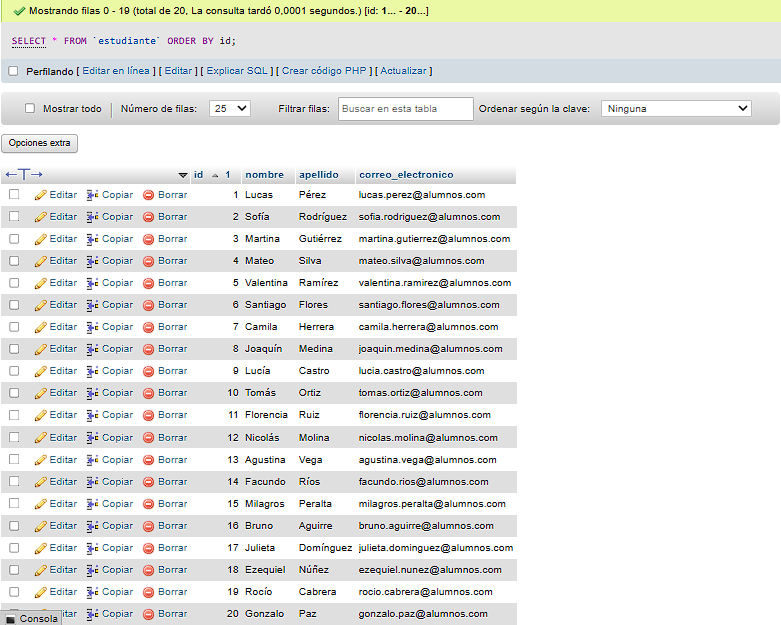

### B02. Nombre completo de cada estudiante (CONCAT y alias con AS)

```sql
SELECT CONCAT(nombre, ' ', apellido) AS nombre_completo,
       correo_electronico
FROM estudiante
ORDER BY id;
```

**Resultado obtenido:**

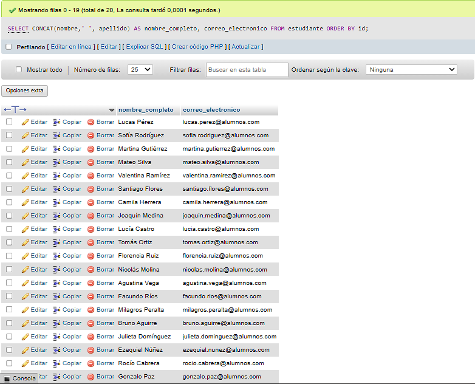

### B03. Cursos que cuestan mas de 50000 (WHERE)

```sql
SELECT titulo, precio FROM curso WHERE precio > 50000
ORDER BY precio DESC;
```

**Resultado obtenido:**

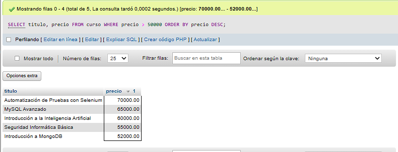

### B04. Cursos con precio entre 40000 y 50000 (BETWEEN)

```sql
SELECT titulo, precio FROM curso WHERE precio BETWEEN 40000 AND 50000
ORDER BY precio;
```

**Resultado obtenido:**

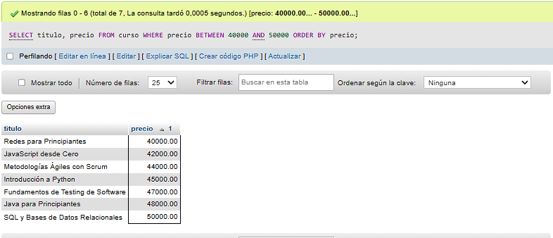

### B05. Cursos cuyo titulo contiene "Introducción" (LIKE)

```sql
SELECT titulo FROM curso WHERE titulo LIKE '%Introducción%'
ORDER BY titulo;
```

**Resultado obtenido:**

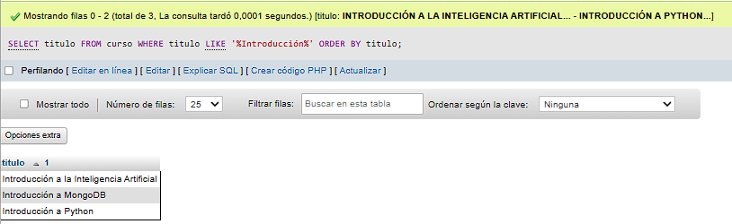

### B06. Cursos de las categorias 1 y 2 con precio menor a 50000 (IN y AND)

```sql
SELECT titulo, id_categoria, precio
FROM curso
WHERE id_categoria IN (1, 2) AND precio < 50000
ORDER BY id;
```

**Resultado obtenido:**

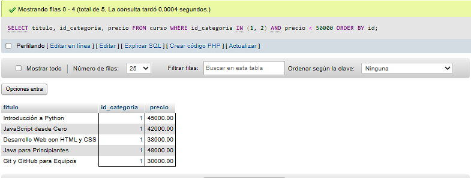

### B07. Los 5 cursos mas caros (ORDER BY + LIMIT)

```sql
SELECT titulo, precio FROM curso ORDER BY precio DESC LIMIT 5;
```

**Resultado obtenido:**

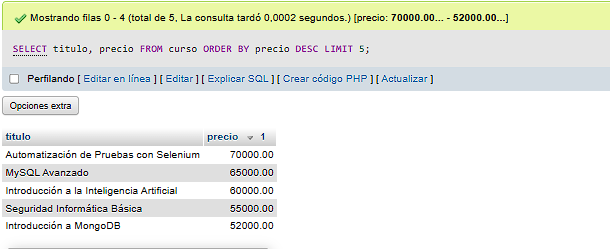

### B08. Precio promedio, minimo y maximo de los cursos (AVG, MIN, MAX)

```sql
SELECT COUNT(*) AS total_cursos,
       AVG(precio) AS precio_promedio,
       MIN(precio) AS mas_barato,
       MAX(precio) AS mas_caro
FROM curso;
```

**Resultado obtenido:**

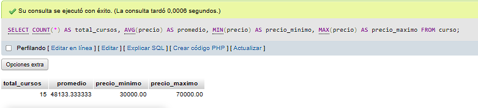

---

## Nivel 2: Intermedio / Avanzado (JOIN, GROUP BY, HAVING, LEFT JOIN)

### I01. Cursos con su categoria y su profesor (JOIN de 3 tablas)

```sql
SELECT c.titulo,
       cat.nombre AS categoria,
       CONCAT(p.nombre, ' ', p.apellido) AS profesor,
       c.precio
FROM curso c
JOIN categoria cat ON cat.id = c.id_categoria
JOIN profesor p ON p.id = c.id_profesor
ORDER BY c.id;
```

**Resultado obtenido:**

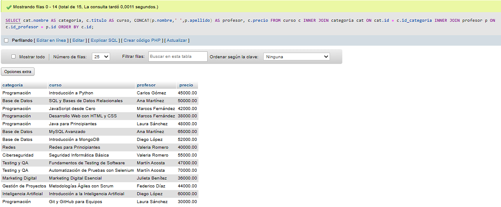

### I02. Estudiantes inscriptos en "Introducción a Python"

```sql
SELECT e.nombre, e.apellido, i.fecha_inscripcion
FROM inscripcion i
JOIN estudiante e ON e.id = i.id_estudiante
JOIN curso c ON c.id = i.id_curso
WHERE c.titulo = 'Introducción a Python'
ORDER BY i.fecha_inscripcion;
```

**Resultado obtenido:**

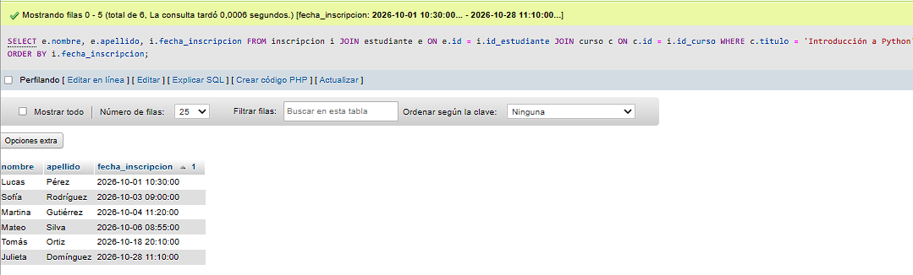

### I03. Lecciones de cada curso, con el titulo del curso

```sql
SELECT c.titulo AS curso, l.titulo AS leccion, l.duracion
FROM leccion l
JOIN curso c ON c.id = l.id_curso
ORDER BY c.id, l.id;
```

**Resultado obtenido:** el resultado ocupa dos páginas en phpMyAdmin, por eso hay dos capturas.

Página 1:

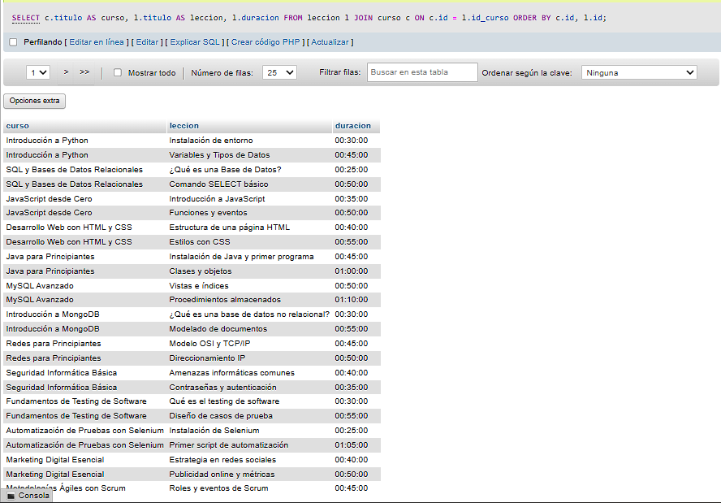

Página 2:


### I04. Cuantos estudiantes tiene cada curso (GROUP BY + LEFT JOIN)

> LEFT JOIN incluye tambien los cursos sin inscriptos (con 0)

```sql
SELECT c.titulo, COUNT(i.id) AS estudiantes_inscriptos
FROM curso c
LEFT JOIN inscripcion i ON i.id_curso = c.id
GROUP BY c.id, c.titulo
ORDER BY estudiantes_inscriptos DESC, c.id;
```

**Resultado obtenido:**

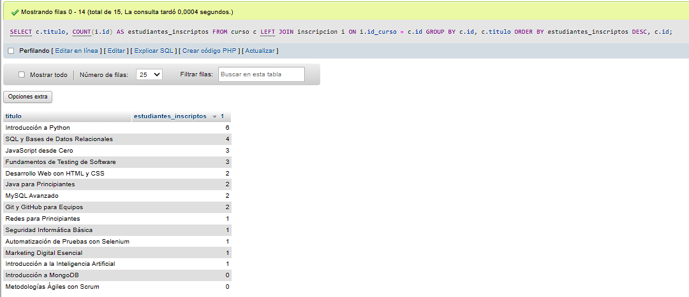

### I05. Cuanto dinero recaudo cada curso (SUM)

```sql
SELECT c.titulo,
       COALESCE(SUM(i.costo_pagado), 0) AS ingresos
FROM curso c
LEFT JOIN inscripcion i ON i.id_curso = c.id
GROUP BY c.id, c.titulo
ORDER BY ingresos DESC, c.id;
```

**Resultado obtenido:**

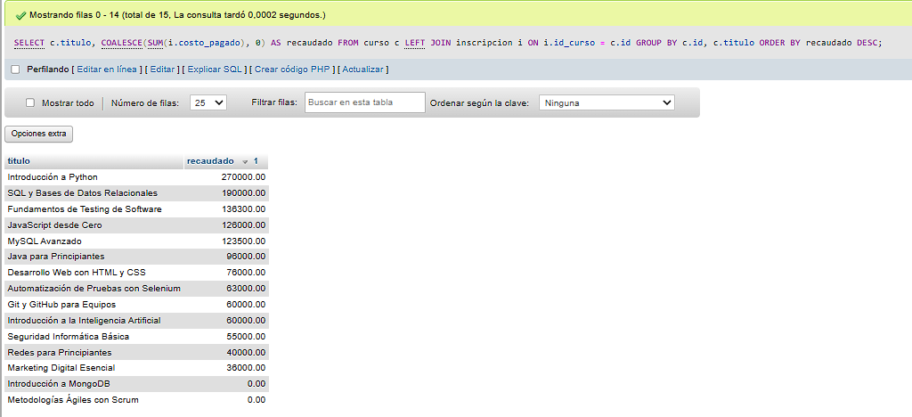

### I06. Cantidad de lecciones y duracion total de cada curso

> TIME_TO_SEC convierte a segundos para poder sumar(duracion esta como hh:mm:ss); SEC_TO_TIME vuelve a pasarlo a hh:mm:ss

```sql
SELECT c.titulo,
       COUNT(l.id) AS cantidad_lecciones,
       SEC_TO_TIME(SUM(TIME_TO_SEC(l.duracion))) AS duracion_total
FROM curso c
LEFT JOIN leccion l ON l.id_curso = c.id
GROUP BY c.id, c.titulo
ORDER BY c.id;
```

**Resultado obtenido:**

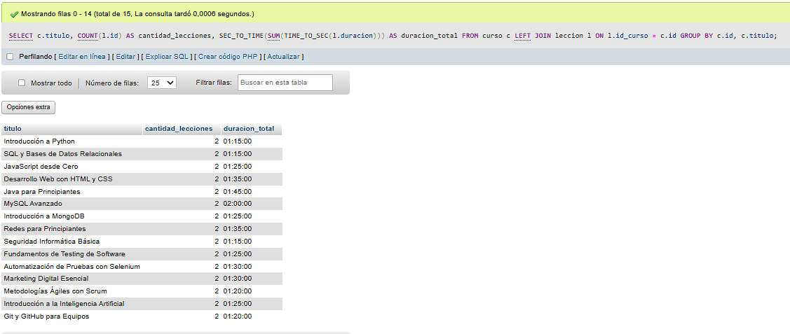

### I07. Cuantos cursos dicta cada profesor

> LEFT JOIN para incluir profesores que todavia no dictan ningun curso

```sql
SELECT CONCAT(p.nombre, ' ', p.apellido) AS profesor,
       COUNT(c.id) AS cursos_dictados
FROM profesor p
LEFT JOIN curso c ON c.id_profesor = p.id
GROUP BY p.id, p.nombre, p.apellido
ORDER BY cursos_dictados DESC, p.id;
```

**Resultado obtenido:**

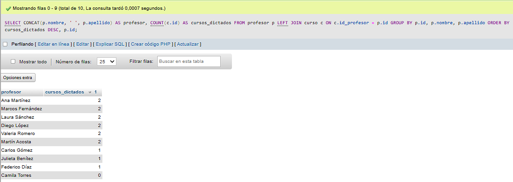

### I08. Categorias que no tienen ningun curso

```sql
SELECT cat.nombre
FROM categoria cat
LEFT JOIN curso c ON c.id_categoria = cat.id
WHERE c.id IS NULL
ORDER BY cat.id;
```

**Resultado obtenido:**

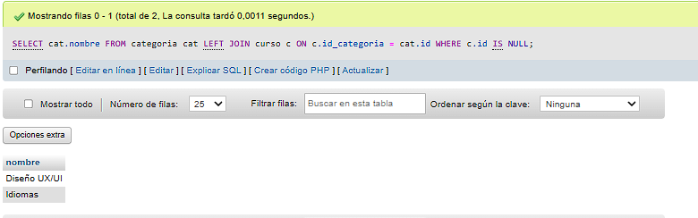

### I09. Estudiantes inscriptos en mas de un curso (HAVING)

> HAVING filtra sobre el resultado de la agrupacion (WHERE no puede hacerlo)

```sql
SELECT e.nombre, e.apellido, COUNT(i.id) AS cursos_inscriptos
FROM estudiante e
INNER JOIN inscripcion i ON i.id_estudiante = e.id
GROUP BY e.id, e.nombre, e.apellido
HAVING COUNT(i.id) > 1
ORDER BY cursos_inscriptos DESC, e.id;
```

**Resultado obtenido:**

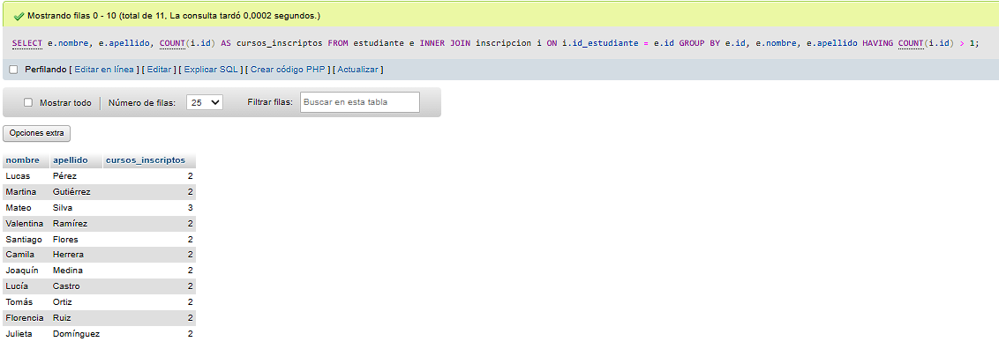

### I10. Cantidad de lecciones de cada curso

> LEFT JOIN para incluir tambien los cursos que todavia no tienen lecciones cargadas

```sql
SELECT c.titulo,
       COUNT(l.id) AS cantidad_lecciones
FROM curso c
LEFT JOIN leccion l ON l.id_curso = c.id
GROUP BY c.id, c.titulo
ORDER BY c.id;
```

**Resultado obtenido:**

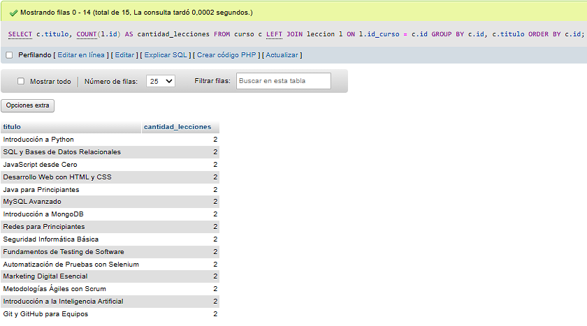

### I11. Cantidad de inscripciones por estudiante

> LEFT JOIN para incluir tambien los estudiantes sin inscripciones (con 0)

```sql
SELECT e.nombre,
       e.apellido,
       COUNT(i.id) AS cantidad_inscripciones
FROM estudiante e
LEFT JOIN inscripcion i ON i.id_estudiante = e.id
GROUP BY e.id, e.nombre, e.apellido
ORDER BY e.id;
```

**Resultado obtenido:**

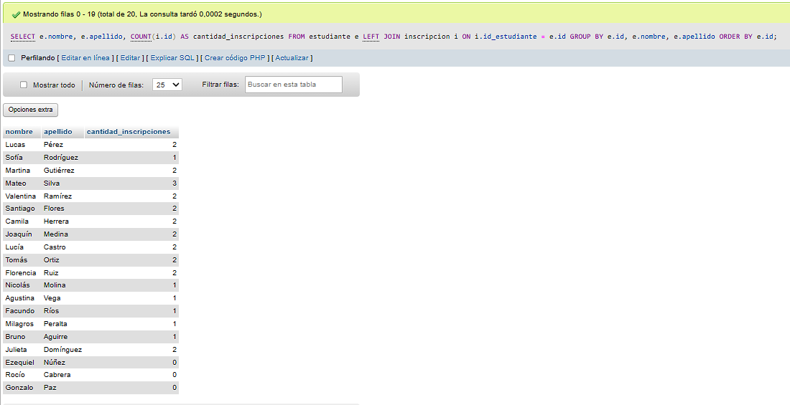

### I12. Recaudacion total por categoria (LEFT JOIN encadenados + SUM + COALESCE)

> COALESCE convierte en 0 el resultado cuando una categoria no tiene dinero recaudado

```sql
SELECT cat.nombre AS categoria,
       COALESCE(SUM(i.costo_pagado), 0) AS recaudado
FROM categoria cat
LEFT JOIN curso c ON cat.id = c.id_categoria
LEFT JOIN inscripcion i ON c.id = i.id_curso
GROUP BY cat.id, cat.nombre
ORDER BY recaudado DESC, cat.id ASC;
```

**Resultado obtenido:**

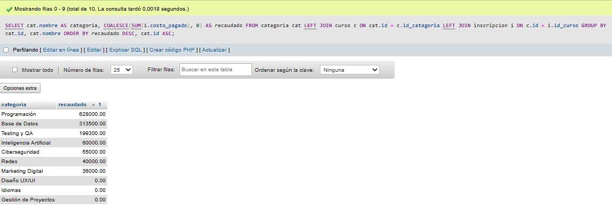

### I13. Reporte por profesor: cursos dictados, inscripciones totales y dinero recaudado

> COUNT(DISTINCT c.id) evita contar cursos repetidos por las multiples inscripciones.

```sql
SELECT p.nombre,
       p.apellido,
       COUNT(DISTINCT c.id) AS cantidad_cursos_dictados,
       COUNT(i.id) AS inscripciones_totales,
       COALESCE(SUM(i.costo_pagado), 0) AS recaudado_por_curso
FROM profesor p
LEFT JOIN curso c ON c.id_profesor = p.id
LEFT JOIN inscripcion i ON i.id_curso = c.id
GROUP BY p.id, p.nombre, p.apellido
ORDER BY p.id;
```

**Resultado obtenido:**

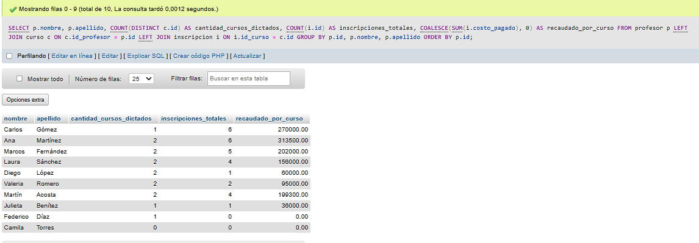

---

## Nivel 3: Avanzado (introducción: subconsultas, fechas y CASE)

### A01. Cursos que cuestan mas que el precio promedio (subconsulta)

```sql
SELECT titulo, precio
FROM curso
WHERE precio > (SELECT AVG(precio) FROM curso)
ORDER BY precio DESC;
```

**Resultado obtenido:**

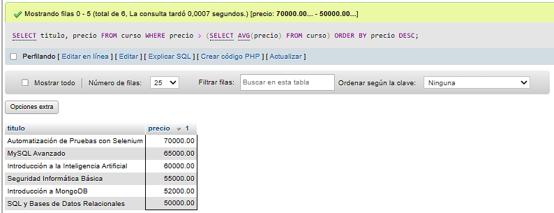

### A02. Cantidad de inscripciones por dia (funciones de fecha)

```sql
SELECT DATE(fecha_inscripcion) AS dia, COUNT(*) AS inscripciones
FROM inscripcion
GROUP BY DATE(fecha_inscripcion)
ORDER BY dia;
```

**Resultado obtenido:** el resultado ocupa dos páginas en phpMyAdmin, por eso hay dos capturas.

Página 1:

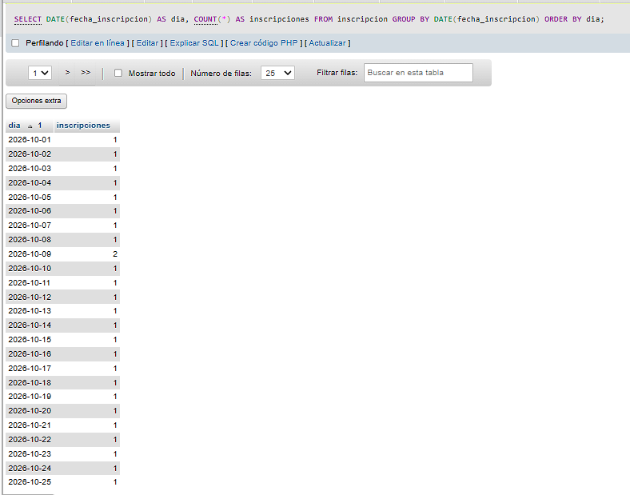

Página 2:

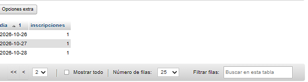

### A03. Clasificar cursos segun su precio (CASE)

```sql
SELECT titulo,
       precio,
       CASE
           WHEN precio < 40000 THEN 'Economico'
           WHEN precio < 55000 THEN 'Intermedio'
           ELSE 'Premium'
       END AS gama
FROM curso
ORDER BY precio;
```

**Resultado obtenido:**

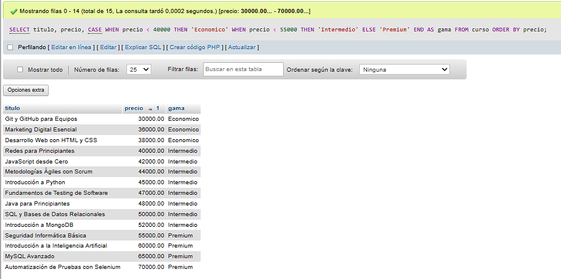
