# CP1: Eliminación en cascada de curso a lecciones

> Parte de los [casos de prueba de EduTech](casos_de_prueba.md). Las sentencias completas, listas para ejecutar, están en [`casos_de_prueba.sql`](casos_de_prueba.sql).

**Escenario**

```gherkin
Dado que existe el curso "QA Curso Prueba"
Y que el curso tiene 2 lecciones
Cuando se elimina el curso
Entonces el curso no existe
Y las lecciones del curso no existen
```

**Qué se verifica:** que al eliminar un curso, sus lecciones se eliminan automáticamente (`ON DELETE CASCADE`), y que el resto de los datos no se ve afectado.

### Estado inicial

#### Paso 0: Totales de registros antes de la prueba

Esta consulta se ejecuta al inicio y al final del caso. Los totales deben ser idénticos.

```sql
SELECT 'categoria' AS tabla, COUNT(*) AS total FROM categoria
UNION ALL SELECT 'profesor',    COUNT(*) FROM profesor
UNION ALL SELECT 'estudiante',  COUNT(*) FROM estudiante
UNION ALL SELECT 'curso',       COUNT(*) FROM curso
UNION ALL SELECT 'leccion',     COUNT(*) FROM leccion
UNION ALL SELECT 'inscripcion', COUNT(*) FROM inscripcion;
```

**Resultado esperado:** con los datos de ejemplo cargados, categoria 10, profesor 10, estudiante 20, curso 15, leccion 30 e inscripcion 29.

**Resultado obtenido:**

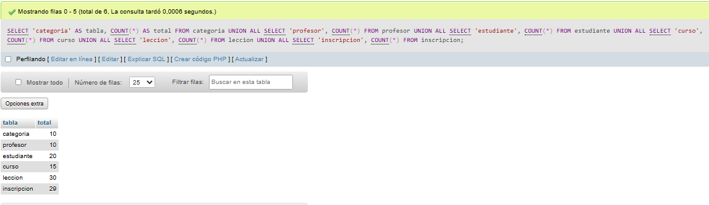

- [x] Coincide con el resultado esperado

### Preparación

#### Paso 1: Verificar que la categoría de prueba no existe

```sql
SELECT * FROM categoria WHERE nombre = 'QA Categoria';
```

**Resultado esperado:** 0 filas.

**Resultado obtenido:**

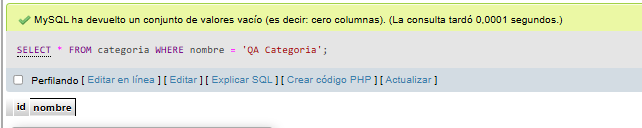

- [x] Coincide con el resultado esperado

#### Paso 2: Verificar que el profesor de prueba no existe

```sql
SELECT * FROM profesor WHERE correo_electronico = 'qa.profesor@test.edutech';
```

**Resultado esperado:** 0 filas.

**Resultado obtenido:**

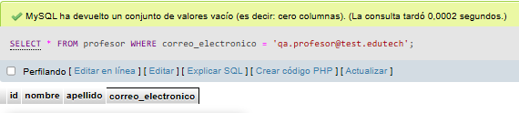

- [x] Coincide con el resultado esperado

#### Paso 3: Verificar que el curso de prueba no existe

```sql
SELECT * FROM curso WHERE titulo = 'QA Curso Prueba';
```

**Resultado esperado:** 0 filas.

**Resultado obtenido:**

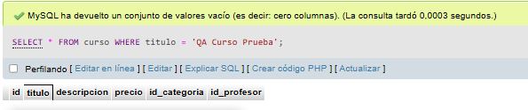

- [x] Coincide con el resultado esperado

#### Paso 4: Insertar la categoría

El curso exige una categoría y un profesor (`NOT NULL`), por eso se crean primero.

```sql
INSERT INTO categoria (nombre) VALUES ('QA Categoria');
```

**Resultado esperado:** 1 fila insertada.

**Resultado obtenido:**

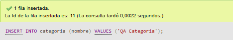

- [x] Coincide con el resultado esperado

#### Paso 5: Insertar el profesor

```sql
INSERT INTO profesor (nombre, apellido, correo_electronico)
VALUES ('QA', 'Profesor', 'qa.profesor@test.edutech');
```

**Resultado esperado:** 1 fila insertada.

**Resultado obtenido:**

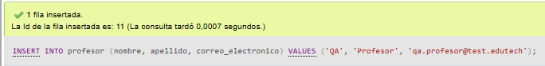

- [x] Coincide con el resultado esperado

#### Paso 6: Insertar el curso

Los IDs de la categoría y del profesor se obtienen con subconsultas, sin usar IDs fijos.

```sql
INSERT INTO curso (titulo, descripcion, precio, id_categoria, id_profesor)
VALUES (
  'QA Curso Prueba', 'Curso para testing', 1000.00,
  (SELECT id FROM categoria WHERE nombre = 'QA Categoria'),
  (SELECT id FROM profesor  WHERE correo_electronico = 'qa.profesor@test.edutech')
);
```

**Resultado esperado:** 1 fila insertada.

**Resultado obtenido:**

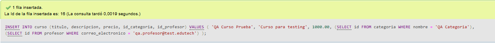

- [x] Coincide con el resultado esperado

#### Paso 7: Insertar las 2 lecciones del curso

```sql
INSERT INTO leccion (titulo, duracion, id_curso) VALUES
('QA Leccion 1', '00:30:00', (SELECT id FROM curso WHERE titulo = 'QA Curso Prueba')),
('QA Leccion 2', '00:45:00', (SELECT id FROM curso WHERE titulo = 'QA Curso Prueba'));
```

**Resultado esperado:** 2 filas insertadas.

**Resultado obtenido:**

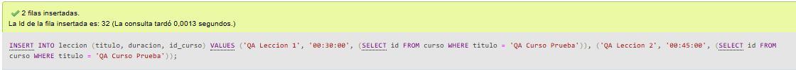

- [x] Coincide con el resultado esperado

#### Paso 8: Verificar la precondición del curso

```sql
SELECT * FROM curso WHERE titulo = 'QA Curso Prueba';
```

**Resultado esperado:** 1 fila.

**Resultado obtenido:**

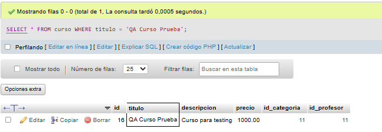

- [x] Coincide con el resultado esperado

#### Paso 9: Verificar la precondición de las lecciones

```sql
SELECT l.*
FROM leccion l
JOIN curso c ON c.id = l.id_curso
WHERE c.titulo = 'QA Curso Prueba';
```

**Resultado esperado:** 2 filas (QA Leccion 1 y QA Leccion 2).

**Resultado obtenido:**

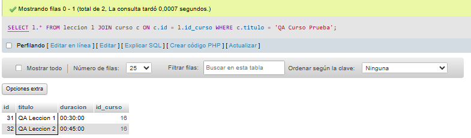

- [x] Coincide con el resultado esperado

### Ejecución

#### Paso 10: Eliminar el curso

```sql
DELETE FROM curso WHERE titulo = 'QA Curso Prueba';
```

**Resultado esperado:** 1 fila eliminada, sin errores. Las lecciones se eliminan por cascada.

**Resultado obtenido:**

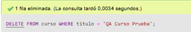

- [x] Coincide con el resultado esperado

### Verificaciones

#### Paso 11: Verificar que el curso no existe

```sql
SELECT * FROM curso WHERE titulo = 'QA Curso Prueba';
```

**Resultado esperado:** 0 filas.

**Resultado obtenido:**

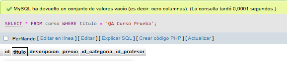

- [x] Coincide con el resultado esperado

#### Paso 12: Verificar que las lecciones no existen

```sql
SELECT * FROM leccion WHERE titulo LIKE 'QA Leccion%';
```

**Resultado esperado:** 0 filas, porque se eliminaron en cascada.

**Resultado obtenido:**

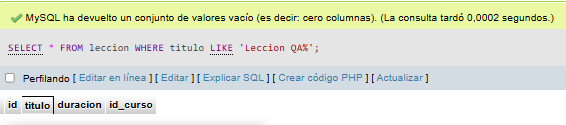

- [x] Coincide con el resultado esperado

### Limpieza

El curso y las lecciones ya se eliminaron en la ejecución. Quedan por eliminar el profesor y la categoría.

#### Paso 13: Eliminar el profesor

```sql
DELETE FROM profesor WHERE correo_electronico = 'qa.profesor@test.edutech';
```

**Resultado esperado:** 1 fila eliminada.

**Resultado obtenido:**

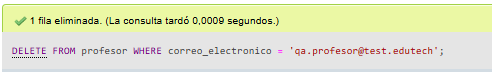

- [x] Coincide con el resultado esperado

#### Paso 14: Eliminar la categoría

```sql
DELETE FROM categoria WHERE nombre = 'QA Categoria';
```

**Resultado esperado:** 1 fila eliminada.

**Resultado obtenido:**

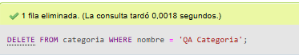

- [x] Coincide con el resultado esperado

#### Paso 15: Verificar que el profesor ya no existe

```sql
SELECT * FROM profesor WHERE correo_electronico = 'qa.profesor@test.edutech';
```

**Resultado esperado:** 0 filas.

**Resultado obtenido:**

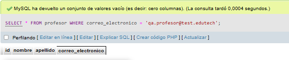

- [x] Coincide con el resultado esperado

#### Paso 16: Verificar que la categoría ya no existe

```sql
SELECT * FROM categoria WHERE nombre = 'QA Categoria';
```

**Resultado esperado:** 0 filas.

**Resultado obtenido:**

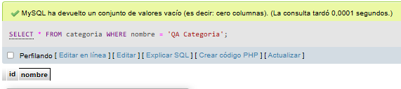

- [x] Coincide con el resultado esperado

### Estado final

#### Paso 17: Totales de registros después de la prueba

Se repite la consulta del paso 0.

**Resultado esperado:** los mismos totales que antes de la prueba (categoria 10, profesor 10, estudiante 20, curso 15, leccion 30 e inscripcion 29).

**Resultado obtenido:**

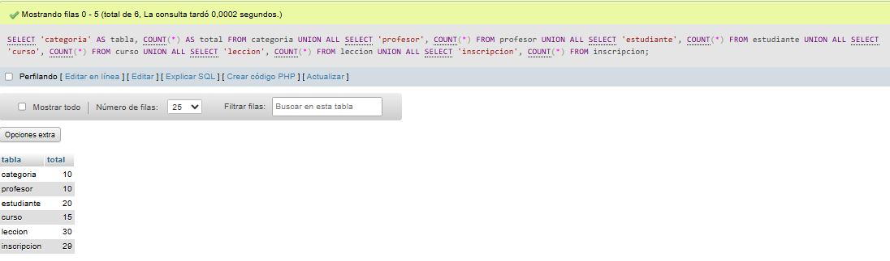

- [x] Coincide con el resultado esperado

### Resultado del caso

- [x] **CP1 aprobado:** todos los pasos dieron el resultado esperado y la base quedó igual que al inicio.
