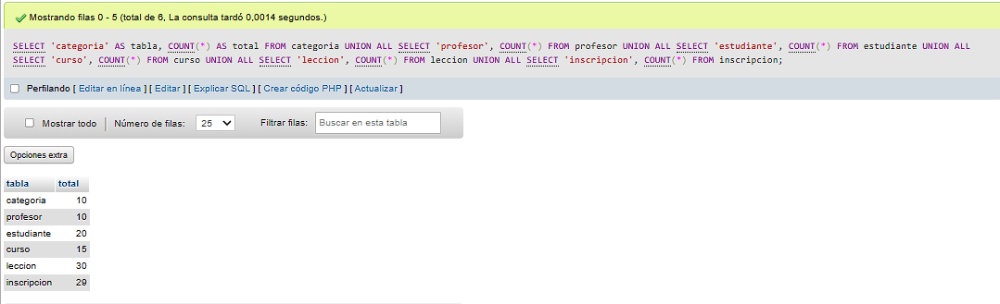
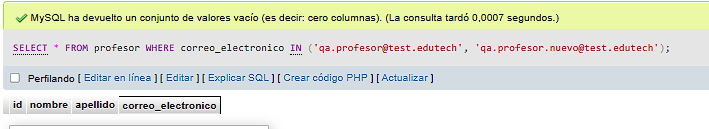
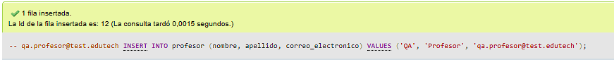
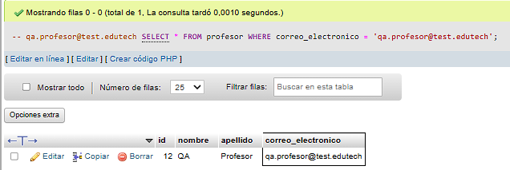
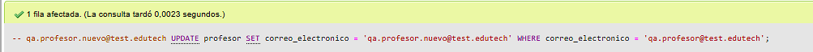
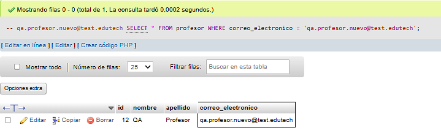
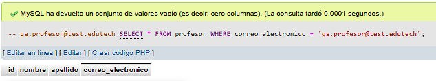
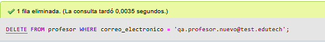
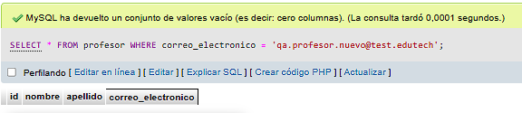
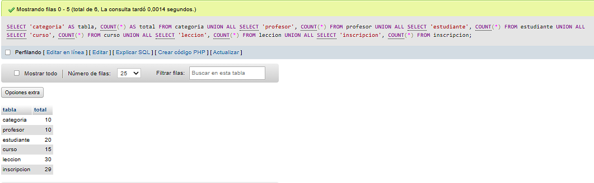

# CP2: Actualización del correo de un profesor

> Parte de los [casos de prueba de EduTech](casos_de_prueba.md). Las sentencias completas, listas para ejecutar, están en [`casos_de_prueba.sql`](casos_de_prueba.sql).

**Escenario**

```gherkin
Dado que existe el profesor "QA Profesor"
Cuando se actualiza su correo electrónico
Entonces el profesor tiene el correo actualizado
Y el correo anterior ya no está asociado a ningún profesor
```

**Qué se verifica:** que al actualizar el correo de un profesor el valor nuevo queda guardado, que el anterior deja de existir, y que el resto de los datos no se ve afectado.

### Estado inicial

#### Paso 0: Totales de registros antes de la prueba

Esta consulta se ejecuta al inicio y al final del caso. Los totales deben ser idénticos.

```sql
SELECT 'categoria' AS tabla, COUNT(*) AS total FROM categoria
UNION ALL SELECT 'profesor',    COUNT(*) FROM profesor
UNION ALL SELECT 'estudiante',  COUNT(*) FROM estudiante
UNION ALL SELECT 'curso',       COUNT(*) FROM curso
UNION ALL SELECT 'leccion',     COUNT(*) FROM leccion
UNION ALL SELECT 'inscripcion', COUNT(*) FROM inscripcion;
```

**Resultado esperado:** con los datos de ejemplo cargados, categoria 10, profesor 10, estudiante 20, curso 15, leccion 30 e inscripcion 29.

**Resultado obtenido:**



- [x] Coincide con el resultado esperado

### Preparación

#### Paso 1: Verificar que el profesor de prueba no existe

Se buscan los dos correos que usa la prueba: el original y el actualizado.

```sql
SELECT * FROM profesor
WHERE correo_electronico IN ('qa.profesor@test.edutech', 'qa.profesor.nuevo@test.edutech');
```

**Resultado esperado:** 0 filas.

**Resultado obtenido:**



- [x] Coincide con el resultado esperado

#### Paso 2: Insertar el profesor

```sql
INSERT INTO profesor (nombre, apellido, correo_electronico)
VALUES ('QA', 'Profesor', 'qa.profesor@test.edutech');
```

**Resultado esperado:** 1 fila insertada.

**Resultado obtenido:**



- [x] Coincide con el resultado esperado

#### Paso 3: Verificar la precondición del profesor

```sql
SELECT * FROM profesor WHERE correo_electronico = 'qa.profesor@test.edutech';
```

**Resultado esperado:** 1 fila.

**Resultado obtenido:**



- [x] Coincide con el resultado esperado

### Ejecución

#### Paso 4: Actualizar el correo del profesor

```sql
UPDATE profesor
SET correo_electronico = 'qa.profesor.nuevo@test.edutech'
WHERE correo_electronico = 'qa.profesor@test.edutech';
```

**Resultado esperado:** 1 fila afectada, sin errores.

**Resultado obtenido:**



- [x] Coincide con el resultado esperado

### Verificaciones

#### Paso 5: Verificar que el profesor tiene el correo nuevo

```sql
SELECT * FROM profesor WHERE correo_electronico = 'qa.profesor.nuevo@test.edutech';
```

**Resultado esperado:** 1 fila, con el correo `qa.profesor.nuevo@test.edutech`.

**Resultado obtenido:**



- [x] Coincide con el resultado esperado

#### Paso 6: Verificar que el correo anterior ya no existe

```sql
SELECT * FROM profesor WHERE correo_electronico = 'qa.profesor@test.edutech';
```

**Resultado esperado:** 0 filas.

**Resultado obtenido:**



- [x] Coincide con el resultado esperado

### Limpieza

#### Paso 7: Eliminar el profesor

```sql
DELETE FROM profesor WHERE correo_electronico = 'qa.profesor.nuevo@test.edutech';
```

**Resultado esperado:** 1 fila eliminada.

**Resultado obtenido:**



- [x] Coincide con el resultado esperado

#### Paso 8: Verificar que el profesor ya no existe

```sql
SELECT * FROM profesor WHERE correo_electronico LIKE 'qa.profesor%@test.edutech';
```

**Resultado esperado:** 0 filas.

**Resultado obtenido:**



- [x] Coincide con el resultado esperado

### Estado final

#### Paso 9: Totales de registros después de la prueba

Se repite la consulta del paso 0.

**Resultado esperado:** los mismos totales que antes de la prueba (categoria 10, profesor 10, estudiante 20, curso 15, leccion 30 e inscripcion 29).

**Resultado obtenido:**



- [x] Coincide con el resultado esperado

### Resultado del caso

- [x] **CP2 aprobado:** todos los pasos dieron el resultado esperado y la base quedó igual que al inicio.
