# CP3: Restricción de borrado de un estudiante con inscripción

> Parte de los [casos de prueba de EduTech](casos_de_prueba.md). Las sentencias completas, listas para ejecutar, están en [`casos_de_prueba.sql`](casos_de_prueba.sql).

**Escenario**

```gherkin
Dado que existe el estudiante "QA Estudiante"
Y que está inscripto al curso "QA Curso Prueba"
Cuando se intenta eliminar el estudiante
Entonces la base rechaza la eliminación (error 1451)
Y el estudiante y su inscripción siguen existiendo
```

**Qué se verifica:** que un estudiante con inscripciones no se puede eliminar (`ON DELETE RESTRICT`), que la base rechaza la operación con el error 1451 y que los datos quedan intactos. Es un caso negativo: lo esperado es el error.

### Estado inicial

#### Paso 0: Totales de registros antes de la prueba

Esta consulta se ejecuta al inicio y al final del caso. Los totales deben ser idénticos.

```sql
SELECT 'categoria' AS tabla, COUNT(*) AS total FROM categoria
UNION ALL SELECT 'profesor',    COUNT(*) FROM profesor
UNION ALL SELECT 'estudiante',  COUNT(*) FROM estudiante
UNION ALL SELECT 'curso',       COUNT(*) FROM curso
UNION ALL SELECT 'leccion',     COUNT(*) FROM leccion
UNION ALL SELECT 'inscripcion', COUNT(*) FROM inscripcion;
```

**Resultado esperado:** con los datos de ejemplo cargados, categoria 10, profesor 10, estudiante 20, curso 15, leccion 30 e inscripcion 29.

**Resultado obtenido:**

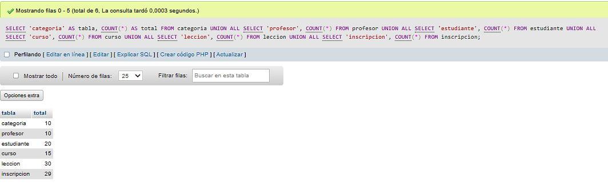

- [ ] Coincide con el resultado esperado

### Preparación

#### Paso 1: Verificar que la categoría de prueba no existe

```sql
SELECT * FROM categoria WHERE nombre = 'QA Categoria';
```

**Resultado esperado:** 0 filas.

**Resultado obtenido:**

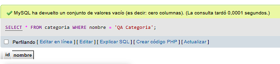

- [x] Coincide con el resultado esperado

#### Paso 2: Verificar que el profesor de prueba no existe

```sql
SELECT * FROM profesor WHERE correo_electronico = 'qa.profesor@test.edutech';
```

**Resultado esperado:** 0 filas.

**Resultado obtenido:**

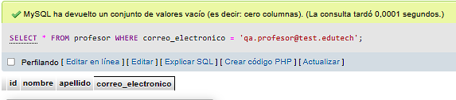

- [x] Coincide con el resultado esperado

#### Paso 3: Verificar que el estudiante de prueba no existe

```sql
SELECT * FROM estudiante WHERE correo_electronico = 'qa.estudiante@test.edutech';
```

**Resultado esperado:** 0 filas.

**Resultado obtenido:**

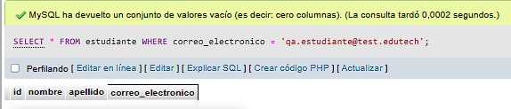

- [x] Coincide con el resultado esperado

#### Paso 4: Verificar que el curso de prueba no existe

```sql
SELECT * FROM curso WHERE titulo = 'QA Curso Prueba';
```

**Resultado esperado:** 0 filas.

**Resultado obtenido:**

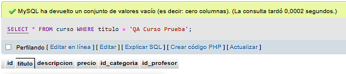

- [x] Coincide con el resultado esperado

#### Paso 5: Verificar que la inscripción de prueba no existe

```sql
SELECT i.*
FROM inscripcion i
JOIN estudiante e ON e.id = i.id_estudiante
WHERE e.correo_electronico = 'qa.estudiante@test.edutech';
```

**Resultado esperado:** 0 filas.

**Resultado obtenido:**

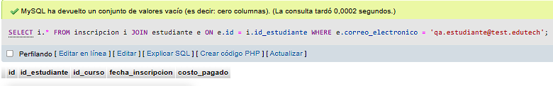

- [x] Coincide con el resultado esperado

#### Paso 6: Insertar la categoría

El curso exige una categoría y un profesor (`NOT NULL`), por eso se crean primero.

```sql
INSERT INTO categoria (nombre) VALUES ('QA Categoria');
```

**Resultado esperado:** 1 fila insertada.

**Resultado obtenido:**

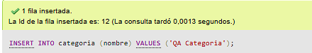

- [x] Coincide con el resultado esperado

#### Paso 7: Insertar el profesor

```sql
INSERT INTO profesor (nombre, apellido, correo_electronico)
VALUES ('QA', 'Profesor', 'qa.profesor@test.edutech');
```

**Resultado esperado:** 1 fila insertada.

**Resultado obtenido:**

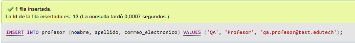

- [x] Coincide con el resultado esperado

#### Paso 8: Insertar el estudiante

```sql
INSERT INTO estudiante (nombre, apellido, correo_electronico)
VALUES ('QA', 'Estudiante', 'qa.estudiante@test.edutech');
```

**Resultado esperado:** 1 fila insertada.

**Resultado obtenido:**

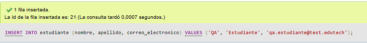

- [x] Coincide con el resultado esperado

#### Paso 9: Insertar el curso

Los IDs de la categoría y del profesor se obtienen con subconsultas, sin usar IDs fijos.

```sql
INSERT INTO curso (titulo, descripcion, precio, id_categoria, id_profesor)
VALUES (
  'QA Curso Prueba', 'Curso para testing', 1000.00,
  (SELECT id FROM categoria WHERE nombre = 'QA Categoria'),
  (SELECT id FROM profesor  WHERE correo_electronico = 'qa.profesor@test.edutech')
);
```

**Resultado esperado:** 1 fila insertada.

**Resultado obtenido:**

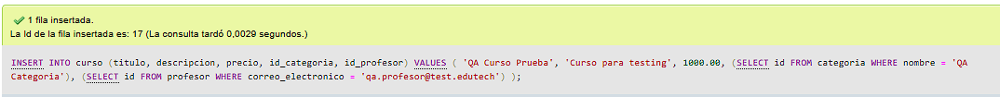

- [x] Coincide con el resultado esperado

#### Paso 10: Insertar la inscripción

La columna `fecha_inscripcion` se completa sola (`DEFAULT CURRENT_TIMESTAMP`).

```sql
INSERT INTO inscripcion (id_estudiante, id_curso, costo_pagado)
VALUES (
  (SELECT id FROM estudiante WHERE correo_electronico = 'qa.estudiante@test.edutech'),
  (SELECT id FROM curso      WHERE titulo = 'QA Curso Prueba'),
  1000.00
);
```

**Resultado esperado:** 1 fila insertada.

**Resultado obtenido:**

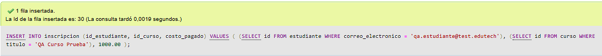

- [x] Coincide con el resultado esperado

#### Paso 11: Verificar la precondición de la inscripción

```sql
SELECT i.*
FROM inscripcion i
JOIN estudiante e ON e.id = i.id_estudiante
WHERE e.correo_electronico = 'qa.estudiante@test.edutech';
```

**Resultado esperado:** 1 fila.

**Resultado obtenido:**

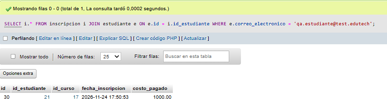

- [x] Coincide con el resultado esperado

### Ejecución

#### Paso 12: Intentar eliminar el estudiante

Esta sentencia se ejecuta **sola**, porque el error corta la ejecución de lo que venga después. Es la acción ("Cuando") y también donde se ve el rechazo ("Entonces"): la captura es el mensaje de error de phpMyAdmin.

```sql
DELETE FROM estudiante WHERE correo_electronico = 'qa.estudiante@test.edutech';
```

**Resultado esperado:** error `#1451 - Cannot delete or update a parent row: a foreign key constraint fails`. No se elimina ninguna fila.

**Resultado obtenido:**

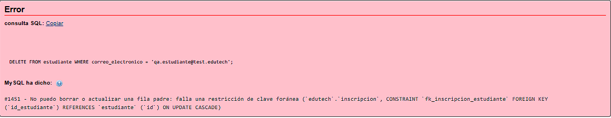

- [x] Coincide con el resultado esperado

### Verificaciones

#### Paso 13: Verificar que el estudiante sigue existiendo

```sql
SELECT * FROM estudiante WHERE correo_electronico = 'qa.estudiante@test.edutech';
```

**Resultado esperado:** 1 fila.

**Resultado obtenido:**

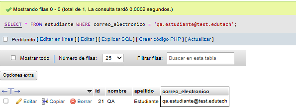

- [x] Coincide con el resultado esperado

#### Paso 14: Verificar que la inscripción sigue existiendo

```sql
SELECT i.*
FROM inscripcion i
JOIN estudiante e ON e.id = i.id_estudiante
WHERE e.correo_electronico = 'qa.estudiante@test.edutech';
```

**Resultado esperado:** 1 fila.

**Resultado obtenido:**

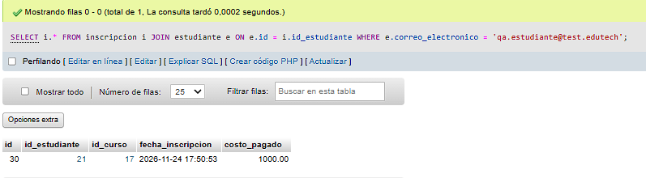

- [x] Coincide con el resultado esperado

### Limpieza

Se elimina en orden inverso al de creación: primero los registros que dependen de otros (hijos) y después los de los que dependen (padres).

#### Paso 15: Eliminar la inscripción

```sql
DELETE FROM inscripcion
WHERE id_estudiante = (SELECT id FROM estudiante WHERE correo_electronico = 'qa.estudiante@test.edutech');
```

**Resultado esperado:** 1 fila eliminada.

**Resultado obtenido:**

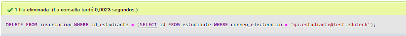

- [x] Coincide con el resultado esperado

#### Paso 16: Eliminar el estudiante

```sql
DELETE FROM estudiante WHERE correo_electronico = 'qa.estudiante@test.edutech';
```

**Resultado esperado:** 1 fila eliminada.

**Resultado obtenido:**

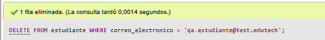

- [x] Coincide con el resultado esperado

#### Paso 17: Eliminar el curso

```sql
DELETE FROM curso WHERE titulo = 'QA Curso Prueba';
```

**Resultado esperado:** 1 fila eliminada.

**Resultado obtenido:**

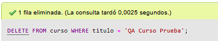

- [x] Coincide con el resultado esperado

#### Paso 18: Eliminar el profesor

```sql
DELETE FROM profesor WHERE correo_electronico = 'qa.profesor@test.edutech';
```

**Resultado esperado:** 1 fila eliminada.

**Resultado obtenido:**

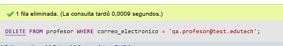

- [x] Coincide con el resultado esperado

#### Paso 19: Eliminar la categoría

```sql
DELETE FROM categoria WHERE nombre = 'QA Categoria';
```

**Resultado esperado:** 1 fila eliminada.

**Resultado obtenido:**

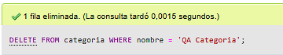

- [x] Coincide con el resultado esperado

#### Paso 20: Verificar que el estudiante ya no existe

```sql
SELECT * FROM estudiante WHERE correo_electronico = 'qa.estudiante@test.edutech';
```

**Resultado esperado:** 0 filas.

**Resultado obtenido:**

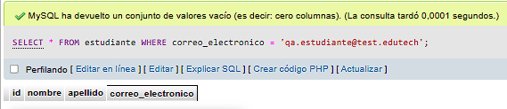

- [x] Coincide con el resultado esperado

#### Paso 21: Verificar que el curso ya no existe

```sql
SELECT * FROM curso WHERE titulo = 'QA Curso Prueba';
```

**Resultado esperado:** 0 filas.

**Resultado obtenido:**

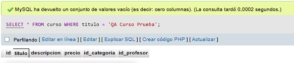

- [x] Coincide con el resultado esperado

#### Paso 22: Verificar que el profesor ya no existe

```sql
SELECT * FROM profesor WHERE correo_electronico = 'qa.profesor@test.edutech';
```

**Resultado esperado:** 0 filas.

**Resultado obtenido:**

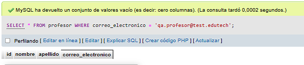

- [x] Coincide con el resultado esperado

#### Paso 23: Verificar que la categoría ya no existe

```sql
SELECT * FROM categoria WHERE nombre = 'QA Categoria';
```

**Resultado esperado:** 0 filas.

**Resultado obtenido:**

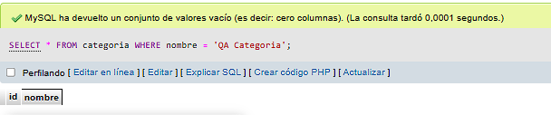

- [x] Coincide con el resultado esperado

### Estado final

#### Paso 24: Totales de registros después de la prueba

Se repite la consulta del paso 0.

**Resultado esperado:** los mismos totales que antes de la prueba (categoria 10, profesor 10, estudiante 20, curso 15, leccion 30 e inscripcion 29).

**Resultado obtenido:**

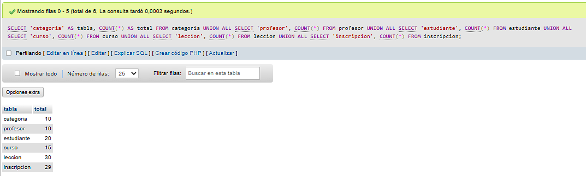

- [x] Coincide con el resultado esperado

### Resultado del caso

- [x] **CP3 aprobado:** todos los pasos dieron el resultado esperado y la base quedó igual que al inicio.
